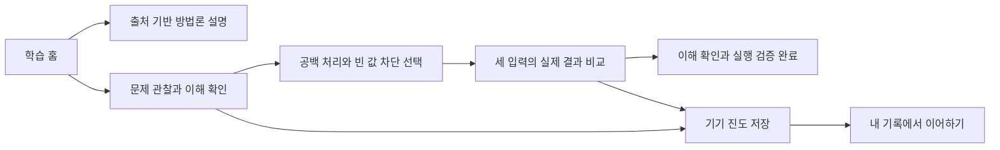
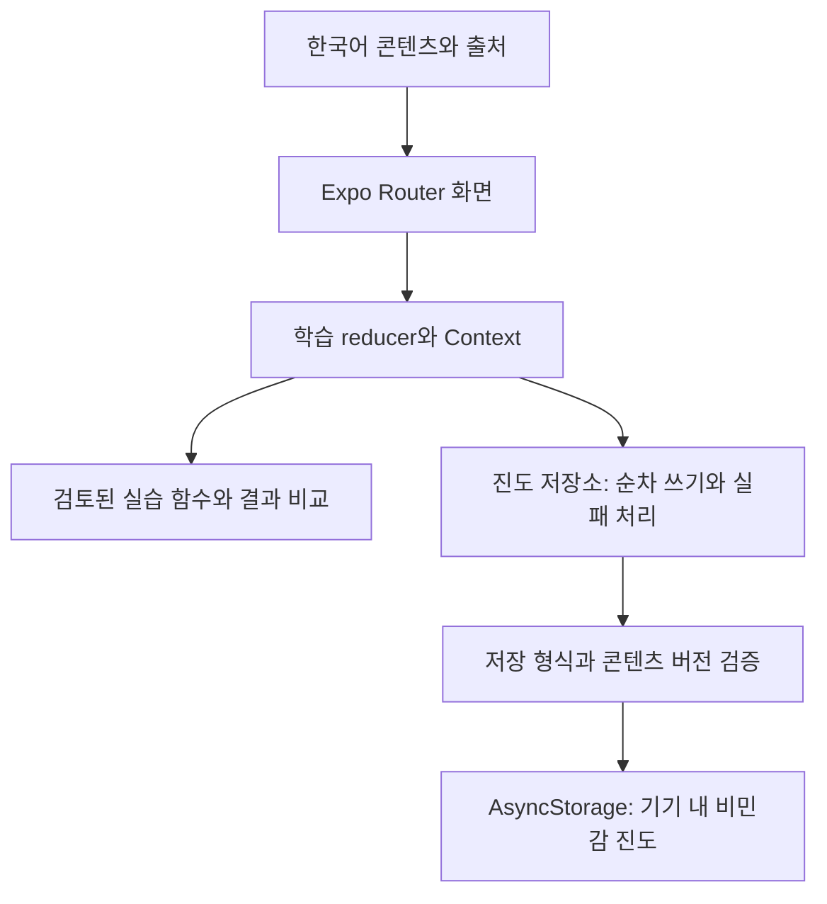

# AICodeT — AI와 함께 개발하는 방법을 배우는 Android 학습 앱

AI가 만든 코드를 이해하고 검증하는 과정을 짧은 설명·이해 확인·코드 선택 실습으로 연결한 개인 프로젝트입니다. 첫 미션은 ‘빈 할 일이 추가되는 오류’를 관찰하고, 원하는 동작을 정리한 뒤, 세 입력의 실제 결과로 수정을 확인하는 흐름입니다.

정리 기준: 2026-11-10 · 앱 0.1.0 · Android 우선 · AI 보조 개발

[소스 저장소](https://github.com/taehyeon98/AICodeT) · [실행 방법](../README.md) · [APK 생성·검사 기록](ANDROID_APK.md) · [시연 대본](DEMO_SCRIPT.md)

## 1. 해결하려는 문제

AI에게 코드를 요청할 수 있어도, 입문자가 문제 상황과 기대 결과를 설명하고 생성된 코드가 실제로 맞는지 확인하는 일은 별도의 학습이 필요합니다. AICodeT는 이 어려움을 제품의 출발 가설로 삼았습니다. 입문자 인터뷰로 일반화한 조사 결과는 아닙니다.

대상은 AI로 코드를 만들어봤지만 요청·코드 이해·오류 설명·검증에 어려움을 느끼는 입문자입니다. 학습 목표는 코드 생성 자체보다 다음 행동을 익히는 것입니다.

- 문제 상황과 기대 결과를 구체적으로 설명하기
- 필요한 코드 개념을 작은 예제로 이해하기
- 예외 입력과 정상 입력을 함께 확인하기
- 실행한 결과와 아직 확인하지 않은 내용을 구분하기

## 2. 첫 미션으로 범위를 좁힌 이유

첫 구현은 로그인 없는 모바일 앱과 오류 수정 미션 하나에 집중했습니다. 작은 미션에서도 요구사항 작성, 문자열·조건문, 실행 비교, 진도 저장까지 하나의 학습 흐름을 구성할 수 있기 때문입니다.

듀오링고의 짧은 활동 단위와 진행 경로를 참고하고, AICodeT의 한국어 설명·크림색과 녹색 화면·세 메뉴로 구성했습니다. 로그인·실제 AI API·자유 코드 실행은 첫 버전에 포함하지 않았습니다. 준비된 요청문은 교육용 예시로 표시하고, 선택형 문항을 실시간 AI 평가처럼 표현하지 않습니다.

## 3. 사용 흐름과 구현 범위

| 화면·활동 | 구현한 동작 | 설계 의도 |
| --- | --- | --- |
| 학습 홈 | 방법론 버튼, 첫 학습 이어하기, 실습 진입 상태 | 개념 설명과 실습을 한 흐름에서 찾게 함 |
| 방법론 | 하네스 상세, 컨텍스트·프롬프트 요약, 근거 링크·확인일 | 공식 사실·자료 해설·가상 예시를 구분 |
| 이해 확인 | 네 문항, 오답 피드백, 답 변경 시 판정 초기화 | 확인하지 않은 답으로 진행하지 않게 함 |
| 코드 실습 | 공백 처리·빈 값 차단 선택, 실제 목록·안내 비교 | 선택한 코드가 요구사항을 만족하는지 관찰 |
| 내 기록 | 단계·답·실습 결과 복원, 다시 풀기·초기화 | 저장 결과와 삭제 영향을 사용자에게 전달 |

현재 구현은 첫 미션과 세 방법론 콘텐츠입니다. AI 개발 가이드 일곱 주제 전체, 독립적인 코딩 기초 사전, 다른 프로젝트 미션은 확장 계획입니다.

## 4. 핵심 설계

### ‘정답 선택’과 ‘문제 해결’을 다른 상태로 관리

문항의 정답을 확인하면 이해 확인을 통과합니다. 전체 미션 완료는 현재 풀이의 이해 확인과 빈 입력·공백 입력·정상 입력의 실행 검증이 모두 통과해야 합니다. 코드를 바꾸면 이전 실행 결과를 지웁니다.

미선택·미확인·오답 상태에서 다음 문항으로 이동하지 못하도록 화면 버튼과 상태 전이에서 조건을 확인합니다. [학습 상태와 완료 조건](../src/features/learning/state.ts), [상태 테스트](../src/features/learning/state.test.ts)

### 코드 조각을 실제 동작과 연결

선택한 공백 처리·빈 문자열 차단 동작에 대응하는 검토된 함수를 실행합니다. 임의 문자열을 eval로 실행하지 않습니다. 각 입력은 같은 초기 목록에서 시작하며, 실제 항목·안내와 기대 결과를 비교합니다.

| 코드 선택 | 빈 입력 | 공백만 입력 | 정상 입력 |
| --- | --- | --- | --- |
| 처리 없이 추가 | 실패 | 실패 | 통과 |
| 빈 문자열만 차단 | 통과 | 실패 | 통과 |
| 공백 제거 후 빈 문자열 차단 | 통과 | 통과 | 통과 |

이 표는 준비된 세 사례에 대한 실행 결과입니다. 모든 입력에서의 안전성을 증명하는 결과로 표현하지 않습니다. [실습 실행 코드](../src/features/playground/runner.ts), [실습 테스트](../src/features/playground/runner.test.ts)

### 저장은 읽기·검증·쓰기 순서까지 포함

앱 시작 때 기록을 읽기 전에는 학습 입력을 받지 않습니다. 저장 형식과 콘텐츠 버전, 답 범위·단계·실행 결과를 검증한 뒤 복원합니다. 변경은 하나의 대기열로 순서대로 저장하고, 최신 요청의 결과로 저장 상태를 표시합니다.

저장 실패 시 현재 풀이를 유지하고 재시도를 제공합니다. 초기화는 사용자 확인 후 대기 중 저장이 끝나면 앱 전용 키만 제거합니다. 손상되거나 미지원인 기록을 조용히 덮어쓰지 않습니다. [저장소](../src/features/progress/store.ts), [복원 검증](../src/features/progress/storage.ts), [호환 정책](PROGRESS_COMPATIBILITY.md)

## 5. 기술 선택

| 구성 | 선택한 이유 |
| --- | --- |
| React Native 0.88.1·Expo SDK 58·TypeScript | Android 네이티브 화면과 엄격한 타입 검사, Expo Go 및 APK 빌드 연결 |
| Expo Router | 탭·방법론 상세·학습·실습 화면의 경로 관리 |
| 순수 reducer·Context·진도 저장소 | 학습 전이와 화면, 비동기 저장 실패를 분리해 확인 |
| AsyncStorage | 계정·서버 없이 기기 내 비민감 학습 기록 저장 |
| Jest·ESLint·GitHub Actions | 로직 검사와 PR별 설치·검사·Android 번들 재현 |

전체 고정 버전과 실제 설치 상태는 [TOOLCHAIN](TOOLCHAIN.md), 작업 방식은 [간단한 GitHub Flow](../CONTRIBUTING.md)에 기록했습니다.

## 6. 문제 해결 사례

| 발생 상황 | 확인한 원인과 조치 | 확인 결과 |
| --- | --- | --- |
| Expo Go에서 프로젝트가 열리지 않음 | 로그에서 기기는 SDK 58, 프로젝트는 SDK 57임을 확인. Expo·React Native·React·관련 패키지와 잠금 파일을 호환 조합으로 전환 | 타입·환경·번들 검사 통과, Expo Go 정상 동작 사용자 보고. [전환 기록](drafts/SDK58_UPGRADE.md) |
| 빠른 연속 저장과 초기화가 겹칠 때 기록 순서가 중요함 | 저장 요청을 직렬화하고 초기화도 같은 대기열에 연결. 오래된 요청 결과가 최신 상태 표시를 바꾸지 않도록 관리 | 지연·실패·삭제 순서를 메모리 어댑터로 검사. 이후 기기의 저장·삭제 정상 사용자 보고. 실제 기기에서 같은 경합을 재현한 결과는 아님 |
| Windows APK 빌드 중 Ninja가 긴 경로를 생성하지 못함 | 기본 CMake 3.22.1·Ninja 1.10.2의 경로 문제를 확인. 공식 안내에 따라 Windows 빌드에 CMake 3.31.6·Ninja 1.12.1 지정 | assembleRelease 성공, APK 서명·ABI·내장 실행 코드 확인. [빌드 기록](ANDROID_APK.md) |

## 7. AI를 활용한 개발 과정과 역할

프로젝트 기획과 구현에 Codex를 사용했습니다. AI에게 요구사항을 전달하고 계획·코드·문서 초안을 생성하게 한 뒤, 도구 실행 결과와 사용자 기기 확인을 근거로 다음 작업을 진행했습니다. 생성된 코드의 양이나 개발 속도를 성과 수치로 제시하지 않습니다.

| 역할 | 확인 가능한 수행 내용 |
| --- | --- |
| 프로젝트 기획자·사용자 | AI 개발론과 코딩 기초를 연결하는 방향, Android 우선·GitHub Flow 결정, 사실 기반 콘텐츠 요구, 적용 승인, Expo Go 버튼·저장·삭제 동작 확인 |
| AI 도구 | 구현·문서 초안, 출처 조회, 상태·저장 로직과 테스트 작성, 오류 로그 분석, 빌드 구성과 PR 작업 수행 |
| 자동 검사 | 타입·린트·테스트·Expo 호환성·Android 번들 및 보안 기준 검사 |

핵심 관리 방식은 목표·제약을 문서로 남기고, 작은 변경을 작업 브랜치에서 확인해 PR로 반영하는 것입니다. 로컬 검증, 자동 검사, 사용자 보고, 아직 확인하지 않은 결과를 별도로 기록합니다. PR 병합은 자기 검토이며 다른 사람의 승인 리뷰를 받은 것으로 표현하지 않습니다.

## 8. 결과와 증거

| 항목 | 확인된 결과 | 범위·제한 |
| --- | --- | --- |
| 핵심 로직 | Jest 4개 스위트·테스트 33개 통과 | 화면 전체의 자동 조작 검사는 아님 |
| 재현성 | GitHub의 깨끗한 npm ci 설치부터 타입·린트·테스트·Expo 호환·Android 번들·보안 기준 통과 | [APK 구성 병합 후 main 실행](https://github.com/taehyeon98/AICodeT/actions/runs/42821379763) |
| Expo Go 기기 확인 | 버튼 검증, 앱 종료 후 진도 복원, 삭제 취소 시 유지, 삭제 후 재실행 시 초기화 유지 정상 보고 | [기기 확인 기록](ANDROID_VALIDATION.md). 개별 접근성 항목 전체를 통과한 결과는 아님 |
| 독립 APK | arm64 설치본 약 27.2 MiB 생성, 서명·식별자·버전·권한·내장 JavaScript 검사 | 내부 테스트 서명. 사용자 요청으로 설치·오프라인 실행 확인은 보류 |
| 보안 검토 | 개발 도구 의존성 경고의 경로·공식 수정 상태·Android 소스맵 검토 | 검토 시 낮음 1·중간 28개가 남음. [보안 검토](SECURITY_REVIEW.md) |

기획·기능 구현은 [PR #6](https://github.com/taehyeon98/AICodeT/pull/6), 자동 검사는 [PR #7](https://github.com/taehyeon98/AICodeT/pull/7), 안정성 기록은 [PR #8](https://github.com/taehyeon98/AICodeT/pull/8), APK 구성은 [PR #9](https://github.com/taehyeon98/AICodeT/pull/9)에서 확인할 수 있습니다.

## 9. 현재 한계와 후속 과제

- 독립 APK의 실제 설치·오프라인 실행과 입문자 3~5명의 관찰은 사용자 요청으로 보류했습니다. 학습 효과·만족도·사용성 개선 수치는 측정하지 않았습니다.
- 전체 가이드와 프로젝트 과정이 완성된 서비스가 아니라 첫 미션 중심의 초기 구현입니다.
- 보안 경고의 호환 수정, 브랜치 보호, 콘텐츠 변경 시 실제 기록 이전, 전용 배포 서명은 남아 있습니다.
- 실제 앱 스크린샷과 시연 영상은 아직 첨부하지 않았습니다. 저장소의 HTML 설계 미리보기를 실제 Android 화면으로 제시하지 않습니다.

후속 작업은 APK 실행 확인과 남은 기기 점검, 호환 가능한 보안 수정, 실제 화면·시연 자료 보완입니다. 전체 목록은 [남은 작업](REMAINING_WORK.md)에 관리합니다.
